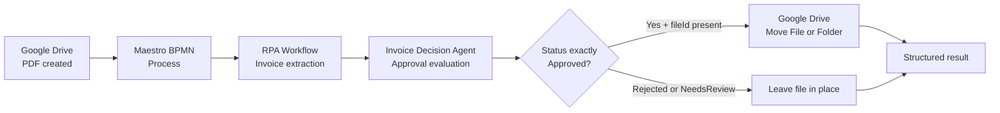

# Invoice Approval & Automated Routing with UiPath

A UiPath automation that monitors Google Drive for newly created invoice PDFs, extracts invoice data, evaluates approval status with a low-code AI agent, and moves approved invoice files to a configured Google Drive destination.

> **Project status:** The source projects are configured and locally validated. A complete production deployment and end-to-end cloud run are not claimed by this README.

## Overview

This solution combines three UiPath projects:

- **Process Orchestration (`BPMN/`)** coordinates the end-to-end process.
- **RPA Workflow (`RPA Workflow/`)** resolves the Google Drive file and extracts invoice fields with UiPath Document Understanding.
- **Invoice Decision Agent (`Agent/`)** evaluates the invoice against the approval policy and conditionally moves approved files through Google Drive Integration Service.



## Process Flow

1. A Google Drive file-created trigger starts the BPMN process for invoice PDFs.
2. The process invokes the RPA extraction workflow with the source file URL or ID.
3. The RPA workflow retrieves the file and extracts invoice data.
4. The process invokes the low-code Invoice Decision Agent.
5. The agent determines the approval status using the fixed policy.
6. For an exact `Approved` result with a populated Google Drive `fileId`, the agent calls the move tool once.
7. The agent returns an approval result and a separate routing result for every invoice.

## Approval Policy

The BPMN process currently supplies this fixed policy to the agent:

- `totalAmount <= 1000 USD` → `Approved`
- `totalAmount > 1000 USD` → `Rejected`
- Missing required information or ambiguous rules → `NeedsReview`

The current policy does **not** require a purchase-order number.

### Routing behavior

| Approval status | File ID | Routing behavior | `moveStatus` |
|---|---|---|---|
| `Approved` | Present | Move the file to the configured approved-invoices folder | `Moved` or `MoveFailed` |
| `Approved` | Missing | Do not call Google Drive | `NeedsReview` |
| `Rejected` | Any | Leave the file in its current location | `NotAttempted` |
| `NeedsReview` | Any | Leave the file in its current location | `NotAttempted` |

The move action uses a no-replace duplicate-name policy. A move failure does not change the approval decision.

## Repository Structure

```text
.
├── Agent/
│   ├── agent.json                         # Low-code agent definition
│   ├── entry-points.json                  # Generated agent contract
│   ├── bindings_v2.json                   # Generated resource bindings
│   ├── evals/                             # Evaluation sets and evaluators
│   └── resources/                         # Google Drive move tool resources
├── BPMN/
│   ├── Process.bpmn                       # Maestro process definition
│   ├── entry-points.json                  # Generated BPMN entry point
│   └── bindings_v2.json                   # Generated BPMN bindings
├── RPA Workflow/
│   ├── Main.xaml                          # Invoice extraction workflow
│   ├── project.json                       # Dependencies and runtime settings
│   └── project.uiproj                     # Studio project metadata
└── README.md
```

Generated files such as `entry-points.json` and `bindings_v2.json` are managed by UiPath tooling. Do not hand-edit them.

## Data Contracts

### RPA workflow input

| Field | Direction | Description |
|---|---|---|
| `FileURL` | Input | Google Drive file URL or ID |

### RPA workflow outputs

| Field | Type | Description |
|---|---|---|
| `InvioceDate` | DateTime | Extracted invoice date. The existing project uses this spelling. |
| `InvioceNumber` | String | Extracted invoice number. The existing project uses this spelling. |
| `InvoiceAmount` | Double | Extracted invoice total amount. |
| `InvoiceVendorName` | String | Extracted vendor name. |

### Agent invoice input

Each invoice can contain:

- `invoiceId`
- `fileId`
- `sourceFolderId`
- `invoiceNumber`
- `vendorName`
- `invoiceDate`
- `dueDate`
- `currency`
- `subtotal`
- `taxAmount`
- `totalAmount`
- `purchaseOrderNumber`
- `costCenter`
- `department`
- `requester`
- `paymentTerms`
- `lineItems`

The BPMN mapping currently sends the core values extracted by the RPA workflow:

```json
{
  "invoiceId": "<invoice-number>",
  "fileId": "<google-drive-file-id>",
  "invoiceNumber": "<invoice-number>",
  "vendorName": "<vendor-name>",
  "invoiceDate": "<invoice-date>",
  "totalAmount": "<invoice-total>"
}
```

### Agent output

```json
{
  "results": [
    {
      "invoiceId": "<invoice-id>",
      "status": "Approved | Rejected | NeedsReview",
      "reason": "Evidence-based approval explanation",
      "moveStatus": "Moved | NotAttempted | NeedsReview | MoveFailed",
      "moveReason": "Evidence-based routing result",
      "movedFileId": "<returned-file-id>"
    }
  ]
}
```

`movedFileId` is populated only when Google Drive confirms a successful move.

## Prerequisites

- UiPath Studio Web with Process Orchestration support.
- UiPath Agent Builder / low-code Agent support.
- An enabled Google Drive Integration Service connection.
- Google Drive permissions to monitor, read, and move invoice files.
- UiPath Document Understanding invoice extraction capability.
- Access to the model configured in `Agent/agent.json`.
- A destination Google Drive folder configured for the move tool.

## Environment Configuration

Before using the solution in another tenant or environment:

1. Configure the Google Drive Integration Service connection.
2. Update the BPMN file-created trigger to the intended source folder and PDF filter.
3. Configure the destination folder in the Google Drive move-tool resource under:
   `Agent/resources/Move Approved Invoice File/resource.json`.
4. Confirm the BPMN process binding points to the deployed RPA workflow.
5. Confirm the BPMN process binding points to the deployed Invoice Decision Agent.
6. Review the fixed approval policy in `BPMN/Process.bpmn`.
7. Confirm that the BPMN mapping receives a populated Google Drive `fileId`.

Never commit access tokens, connection credentials, tenant-specific secrets, or private invoice payloads to GitHub. Use UiPath solution bindings and environment-specific configuration for deployment.

## Local Validation

Run these commands from the relevant project directories after the UiPath CLI is configured:

```bash
# Agent project
cd Agent
uip agent refresh --output json
uip agent validate --output json

# BPMN project
cd ../BPMN
uip maestro bpmn format Process.bpmn
uip maestro bpmn validate Process.bpmn --output json
```

The Agent project includes approval-focused evaluation cases for:

- approval within the threshold;
- rejection above the threshold;
- missing invoice data;
- the exact threshold boundary;
- defensive handling of missing purchase-order data.

Because the production policy no longer requires a purchase order, review the evaluation set before using it as the final acceptance suite.

## Testing Strategy

### 1. Test the Agent independently

Provide a complete invoice object, a populated `fileId`, and the same approval policy used by the BPMN process. Use a safe test file because an approved result can invoke the move tool.

### 2. Test the RPA workflow

Supply a representative invoice PDF URL or ID and confirm that the workflow returns non-empty values for invoice number, vendor name, invoice date, and total amount.

### 3. Test the BPMN process

Create a controlled test PDF in the monitored Google Drive source folder. Confirm that:

- the extraction workflow completes;
- the agent receives non-empty invoice fields;
- `status` is correct;
- `moveStatus` is `Moved` for an approved invoice with a valid file ID;
- `movedFileId` is populated after a successful move.

### 4. Test negative paths

Test at least these scenarios:

- total above the approval threshold;
- missing total amount;
- missing Google Drive `fileId`;
- duplicate file name in the destination folder;
- insufficient Google Drive permissions;
- malformed or unreadable invoice PDF.

## Troubleshooting

### The Agent returns `NeedsReview`

Check that:

- `approvalRules` is not empty;
- `totalAmount` is populated and numeric;
- the BPMN process is passing the extracted values;
- the deployed BPMN definition contains the latest fixed policy.

### The invoice is approved but does not move

Check the result fields in this order:

1. `status` must be exactly `Approved`.
2. `fileId` must contain the Google Drive file ID.
3. `moveStatus` should be `Moved`.
4. `moveStatus: NeedsReview` indicates that the file ID was missing.
5. `moveStatus: MoveFailed` indicates a Google Drive or tool execution failure; inspect `moveReason`.
6. Confirm the destination folder and connection permissions for the current environment.

### The RPA workflow returns empty fields

Check the input `FileURL`, Google Drive access, document quality, and Document Understanding configuration. The current workflow uses the predefined `Invoices` document type and maps extracted values through Assign activities.

## Security and Privacy

- Store credentials in UiPath connections, never in source files.
- Treat invoice files and extracted fields as confidential business data.
- Do not log complete invoice payloads or file contents in public CI logs.
- Use environment-specific bindings for source and destination folders.
- Review Google Drive move permissions before enabling production processing.

## Deployment Checklist

- [ ] Google Drive connection is enabled and authorized.
- [ ] Source-folder trigger is configured for the target environment.
- [ ] Destination folder is configured for the target environment.
- [ ] RPA extraction workflow is deployed and returns populated outputs.
- [ ] Invoice Decision Agent is deployed with the expected Google Drive tool binding.
- [ ] BPMN bindings reference the correct deployed projects.
- [ ] Agent and BPMN validation pass.
- [ ] A controlled test invoice completes successfully.
- [ ] `moveStatus: Moved` and `movedFileId` are verified.
- [ ] Monitoring and failure-handling ownership is documented.
