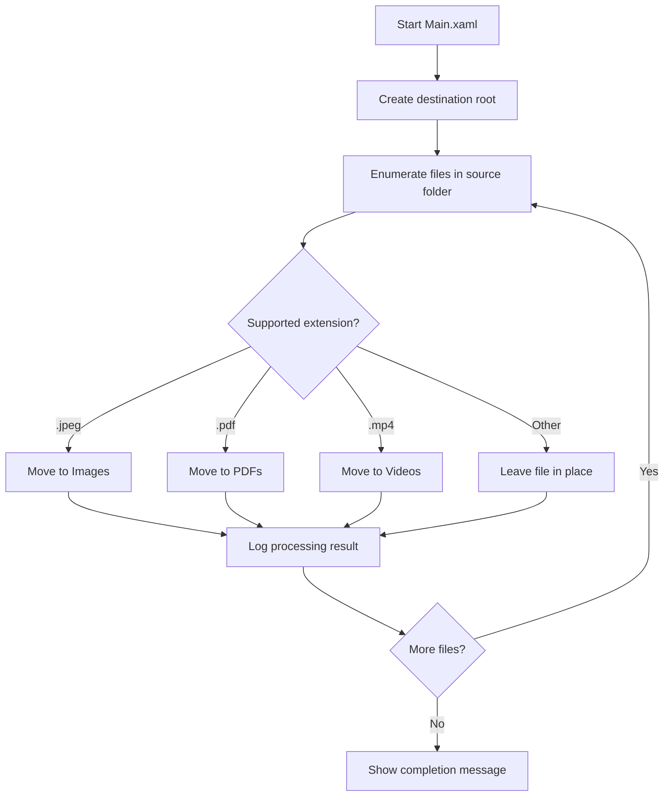

# Intelligent File Organizer

A UiPath Windows process that organizes files from a source directory into category-based subfolders using their file extensions.

The automation is implemented in `Main.xaml` and is designed for local attended execution from UiPath Studio or UiPath Assistant.

## Overview

The workflow:

1. Ensures the destination root folder exists.
2. Scans the configured source folder, without traversing subfolders.
3. Reads each file's extension.
4. Routes supported file types to category folders.
5. Logs the file-processing operation.
6. Displays a completion message when processing finishes.



## Supported file types

| Extension | Destination folder |
|---|---|
| `.jpeg` | `Images` |
| `.pdf` | `PDFs` |
| `.mp4` | `Videos` |

Extensions are normalized to lowercase before routing, so uppercase and mixed-case variants such as `.JPEG`, `.Pdf`, and `.MP4` are recognized.

Files with other extensions are not moved.

## Project details

| Property | Value |
|---|---|
| Project name | `IntelligentFileOrganizer` |
| Project type | Process |
| Target framework | Windows |
| Expression language | Visual Basic |
| Entry point | `Main.xaml` |
| UiPath Studio | `26.0.204` |
| Runtime target | `.NET 10` |
| Main dependency | `UiPath.System.Activities 26.10.0` |

## Prerequisites

- Windows.
- UiPath Studio 26.0 or a compatible UiPath runtime.
- Permission to read the source folder.
- Permission to create folders and move files in the destination location.
- The source folder must exist before execution.
- The destination location must be writable.

## Configuration

The source and destination paths are currently stored as workflow variable defaults in `Main.xaml`:

```text
SourceFolder    = C:\Users\as\Downloads\UiPath_Test\downloads_task
DestinationRoot = C:\Users\as\Downloads\UiPath_Test\downloads_task\OrganizedFiles
```

### Configure the folders

1. Open the project in UiPath Studio.
2. Open `Main.xaml`.
3. In the Variables panel, update the default value of `SourceFolder`.
4. Update the default value of `DestinationRoot`.
5. Save the workflow.
6. Validate the project before running it.

The destination root can be inside or outside the source folder. The workflow enumerates the source files once at the start of the file loop and does not include subfolders.

> **Recommendation:** For reuse across machines or environments, replace the hard-coded paths with workflow input arguments, environment-specific configuration, or an Orchestrator asset rather than committing machine-specific paths to the workflow.

## How to run

### From UiPath Studio

1. Open the project folder in UiPath Studio.
2. Confirm the `SourceFolder` and `DestinationRoot` values.
3. Select `Main.xaml` as the entry point.
4. Validate the project.
5. Run or debug the workflow.

### From the UiPath CLI

From a shell with the UiPath CLI available:

```powershell
uip rpa validate --file-path ".\Main.xaml" --project-dir "." --output json
uip rpa build "." --output json
uip rpa run ".\Main.xaml" --project-dir "." --output json
```

Run commands from the project root. The workflow may move files on the local machine, so verify the configured paths before execution.

## Project structure

```text
scrapping_browser/
├── Main.xaml       # Main workflow and file-routing logic
├── project.json    # UiPath project manifest and dependencies
├── project.uiproj  # Studio project metadata
├── README.md       # Project documentation
├── .settings/      # Project settings
├── .project/       # Studio project metadata
└── .local/         # Generated local files; do not edit or commit
```

The project folder is named `scrapping_browser`, while the UiPath project manifest identifies the process as `IntelligentFileOrganizer`.

## Implementation notes

- The workflow uses `For Each File in Folder` with subfolder traversal disabled.
- Files are processed in ascending name order.
- Category folders are created on demand.
- File moves preserve the original file name.
- Existing files with the same name at the destination may cause the move operation to fail, depending on the runtime and file-system state.
- The workflow does not currently archive, copy, rename, or delete files; supported files are moved from the source directory.

## Known limitations

- Only `.jpeg`, `.pdf`, and `.mp4` are categorized.
- The source and destination paths are machine-specific workflow defaults.
- The workflow does not process files inside source subfolders.
- There is no explicit validation that the source folder exists before the file loop begins.
- There is no dedicated exception-handling branch for locked files, duplicate names, access-denied errors, or partially unavailable files.
- The current logging activity is placed after the extension switch and reports a processing message for every iterated file. For unsupported extensions, the file remains in place, but the message may not accurately describe a move.
- The completion message is shown after the loop regardless of whether individual file operations encountered runtime errors.

## Suggested improvements

The next production-hardening steps would be:

1. Convert `SourceFolder` and `DestinationRoot` into input arguments or configuration values.
2. Add explicit source-folder and destination-access checks.
3. Add `Try Catch` handling around each file transaction.
4. Log separate outcomes for moved, skipped, and failed files.
5. Expand the extension-to-category mapping, preferably from configuration rather than nested workflow branches.
6. Add collision handling for files with duplicate names.
7. Add a summary containing counts for processed, moved, skipped, and failed files.
8. Add a test dataset and a repeatable validation scenario.

## Maintenance guidance

When changing the workflow:

- Keep `Main.xaml` as the entry point unless the project manifest is intentionally updated.
- Keep `project.json` and the workflow compatible with the Windows target framework.
- Use Visual Basic expressions consistently with the current project configuration.
- Avoid editing generated `.local` content manually.
- Validate the changed workflow and build the whole project before publishing or sharing it.
- Test with representative files and confirm both source and destination paths before execution.
